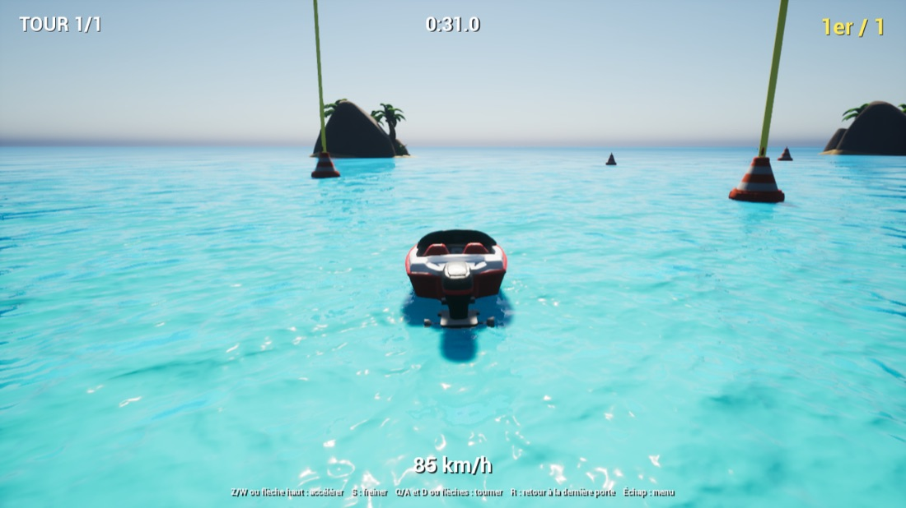

# Lagoon Rush

Course de bateaux à 4 joueurs dans un lagon. 3 tours, le premier arrivé gagne.

## Télécharger (Mac)

**[Télécharger LagoonRush-Mac.zip](https://github.com/Neta08-svg/lagoon-rush/releases/latest/download/LagoonRush-Mac.zip)** (environ 370 Mo)

Il faut un Mac avec une puce Apple (M1 ou plus récente) et macOS 14 ou plus. Pas encore de version Windows.

## Installer

1. Ouvre `LagoonRush-Mac.zip` (double-clic) : tu obtiens `LagoonRush`.
2. Glisse `LagoonRush` dans le dossier Applications, puis ouvre-le.
3. Au premier lancement, macOS bloque les applis qui ne viennent pas de l'App Store :
   ouvre **Réglages Système → Confidentialité et sécurité**, descends, clique **« Ouvrir quand même »**.
   C'est à faire une seule fois.

Si le jeu se ferme tout seul au lancement (rare), relance-le.

## Jouer à plusieurs

- **Un seul joueur héberge** : il clique **HÉBERGER UNE PARTIE** et attend ses amis sur la ligne de départ.
- **Les autres rejoignent** :
  - menu « En ligne : prêt » → **REJOINDRE EN LIGNE**, puis clic sur « Partie de … » ;
  - sinon → taper l'adresse IP affichée chez l'hôte, puis **REJOINDRE PAR IP**
    (même Wi-Fi ; depuis une autre maison, l'hôte ouvre le port 7777 UDP sur sa box).
- Quand tout le monde est là (4 au maximum), l'hôte appuie sur **Entrée**.
- Tous les joueurs doivent avoir **la même version** du jeu.

## Touches

| Action | Clavier | Manette |
|---|---|---|
| Accélérer | Z ou W, flèche haut | gâchette droite |
| Freiner / reculer | S, flèche bas | gâchette gauche |
| Tourner | Q ou A, D, flèches | stick gauche |
| Revenir à la dernière porte | R | bouton du haut |
| Lancer la course (hôte) | Entrée | Start |
| Menu pause | Échap | Select |

Passe entre les deux bouées de chaque porte, dans l'ordre : deux grands mâts jaunes montrent la prochaine.
